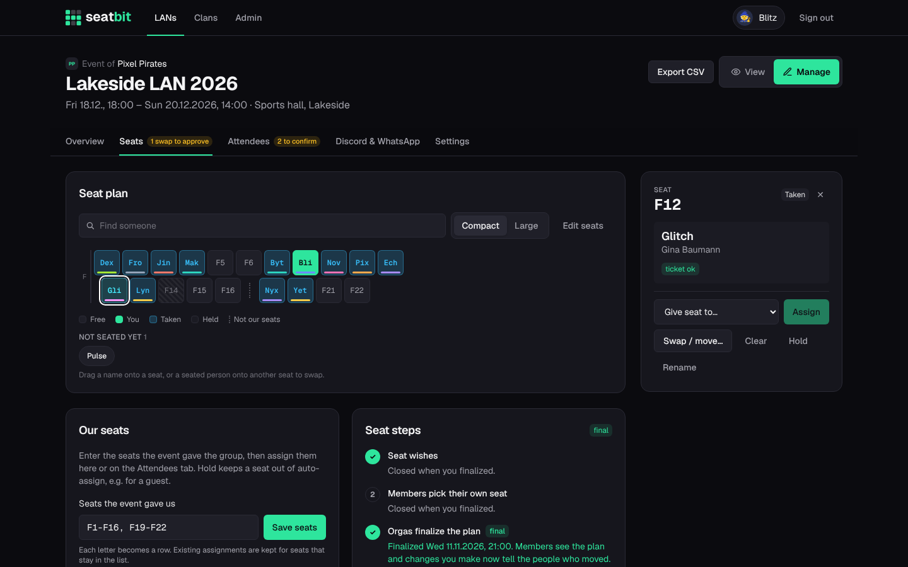
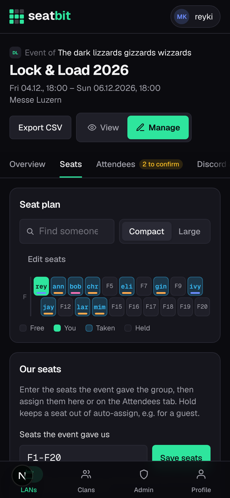

# Seat plan

Orgas plan seats on **Manage → Seats**.

{ .shot }

## Enter the group's seats

Under **Our seats**, enter the seats the event gave you, e.g. `F1-F16, F19-F22`. Each letter becomes a row and each seat sits at its number, so gaps (seats that aren't yours) show as a dotted line. Saving again keeps existing assignments for seats that stay in the list. **Edit seats** in the map shows every number of a row: tap a dashed one to add it or a seat to remove it.

## Assign seats

Tap a seat to open its details:

- **Give seat to** someone, **Swap / move** two people, **Clear** it,
- **Hold** it (members can't take it and auto-assign skips it, e.g. for a guest),
- **Rename** it to match the event's numbering.

People who are coming but have no seat are listed under **Not seated yet**: tap one and then a seat. On desktop you can drag names onto seats and drag seated people onto other seats to swap.

**Fill free seats** seats everyone without a seat; **Re-plan everyone** starts over. The planner follows seat wishes (near, not next to, edge or middle, a preferred seat) and seats people with a ticket first.

<figure markdown>

{ .shot width="300" }

</figure>

## Seat steps

1. **Seat wishes:** members tell you where they'd like to sit.
2. **Members pick their own seat** (optional): turn it on to let members with a ticket take a free seat themselves.
3. **Orgas finalize the plan:** check the plan and finalize it. This closes wishes and self pick, shows everyone the plan and can tell everyone their seat. Changes after that tell the people who moved. **Reopen** goes back.

## Booking on the event site

If the event has its own seat plan link, each member gets a checklist step and a Discord DM to book their seat there once you finalize. The **Attendees** tab shows who booked (*booked on site*) and you can remind the rest. A seat change clears the tick.

## Seat swaps

After the plan is final, members can ask each other to swap. Once the other person agrees, the swap shows up on the Seats tab for an orga to **approve** or reject.
