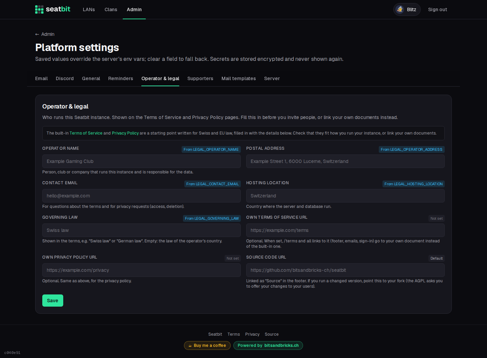

# Operator, privacy and terms

Every Seatbit instance is run by someone, the **operator**, who is responsible for it and for the personal data in it. If you host Seatbit, that's you, not the authors of the software.

Seatbit has a built-in **Terms of Service** (`/terms`) and **Privacy Policy** (`/privacy`). They are linked in the footer, on the sign-in page and in every email. They describe what Seatbit stores and why, and are written for Swiss data protection law (FADP) and the EU GDPR.

## Fill in your details

Under **Admin → Platform settings → Operator & legal** (or with the `LEGAL_*` variables):

| Field | Shown as |
| --- | --- |
| Operator name | Who runs the instance and is the data controller (a person, club or company). |
| Postal address | The operator's address. |
| Contact email | For questions and privacy requests (access, deletion). |
| Hosting location | "This Seatbit instance runs on a server in …". |
| Governing law | "These terms are governed by …", e.g. *Swiss law*. Empty: the law of the operator's country. |

{ .shot }

Until the name and contact email are set, the legal pages and the admin page show a warning.

## Use your own documents

If the built-in texts don't fit (another country's law, a club with its own policy, other service providers), write your own and set **Own Terms of Service URL** and **Own Privacy Policy URL**. `/terms` and `/privacy` then redirect there, so all links in the app and in emails go to your documents.

!!! note
    The built-in texts are a starting point, not legal advice. Read them and check that they match how you run your instance: where it's hosted, which email provider you use, how long you keep backups.

## License obligations

Seatbit is licensed under the [GNU AGPL-3.0](https://github.com/bitsandbricks-ch/seatbit/blob/main/LICENSE) with two [additional terms](https://github.com/bitsandbricks-ch/seatbit/blob/main/NOTICE.md):

- Keep the **"Powered by bitsandbricks.ch"** link in the footer.
- Keep the **"Source"** link in the footer. If you changed the code, set **Source code URL** (`SOURCE_URL`) to where your users can get your version: the AGPL requires you to offer the source of a modified version to the people who use it over the network.

Running the unchanged image needs nothing beyond that.
