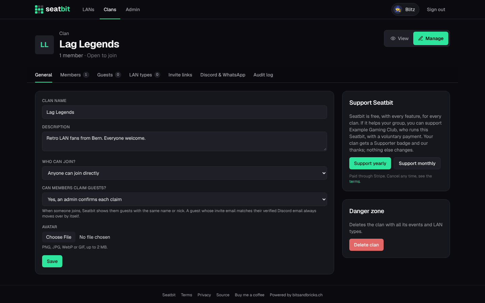
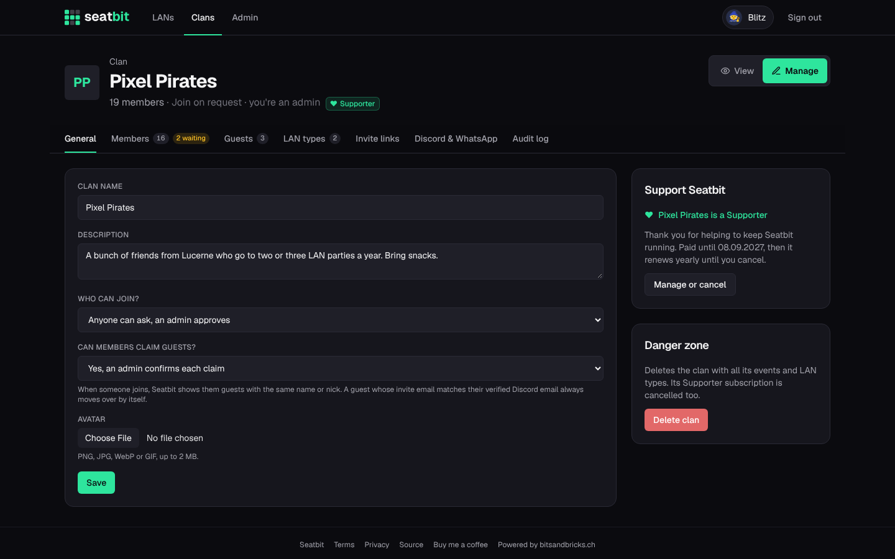
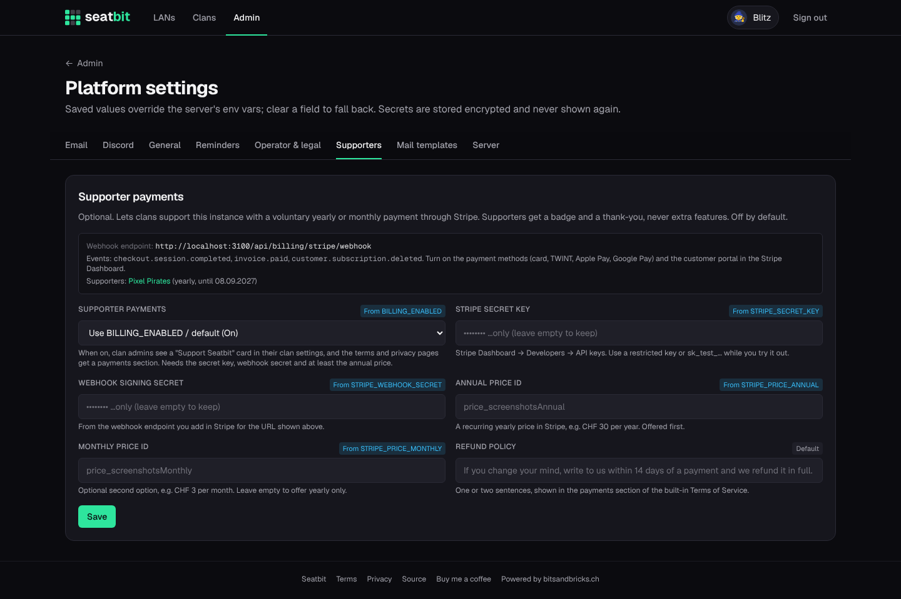

# Supporter payments (Stripe)

Seatbit is free, with every feature, for every clan. If you host an instance for others, you can let clans **support** it with a voluntary yearly (or monthly) payment through [Stripe](https://stripe.com). Supporters get a small badge on their clan and a thank-you; nothing else changes. There are no plans, limits or locked features.

This is **off by default**. Until you turn it on, nobody sees anything about payments: no card in the clan settings, no badge, no payments section in the terms or privacy policy. Most self-hosters never need it.

## What clan admins see

With payments on, clan admins get a **Support Seatbit** card in their clan settings (*Manage → General*). The annual option comes first, to keep fees low; the monthly one is there if you set a monthly price. Paying opens Stripe Checkout, with whatever payment methods you turned on in Stripe (card, TWINT, Apple Pay, Google Pay).

{ .shot }

A Supporter clan shows a **Supporter** badge next to its name, and its members see a short thank-you on the clan overview. Admins see until when it's paid and a **Manage or cancel** button, which opens the Stripe customer portal (change the payment method, receipts, cancel). A cancelled subscription keeps the badge until the end of the paid period. Deleting a clan cancels its subscription right away.

{ .shot }

## Set it up

1. **Create a Stripe account** and switch to *Test mode* while you try it out.
2. **Turn on payment methods** under *Settings → Payments → Payment methods*: cards, TWINT, Apple Pay and Google Pay. TWINT needs prices in CHF. Checkout shows the methods that are on and fit the price.
3. **Create a product**, e.g. *Seatbit Supporter*, with a **recurring price per year** (e.g. CHF 30) and, if you like, a second **recurring price per month** (e.g. CHF 3). Copy the price IDs (`price_…`).
4. **Set up the customer portal** under *Settings → Billing → Customer portal*: allow customers to cancel and update their payment method, and save it once.
5. **Add a webhook endpoint** under *Developers → Webhooks* with the URL shown in Seatbit (`https://seatbit.example.com/api/billing/stripe/webhook`) and these events:
    - `checkout.session.completed`
    - `invoice.paid`
    - `customer.subscription.deleted`

    Copy its **signing secret** (`whsec_…`).
6. In Seatbit, open **Admin → Platform settings → Supporters**, enter the secret key, the webhook signing secret and the price IDs, and turn on **Supporter payments**. Or set the environment variables below.

{ .shot }

| Setting | Variable | |
| --- | --- | --- |
| Supporter payments | `BILLING_ENABLED` | `false` by default. |
| Stripe secret key | `STRIPE_SECRET_KEY` | `sk_test_…` / `sk_live_…`, or a restricted key (`rk_…`) with write access to Checkout Sessions, Customer portal and Subscriptions, and read access to Prices. |
| Webhook signing secret | `STRIPE_WEBHOOK_SECRET` | `whsec_…` |
| Annual price ID | `STRIPE_PRICE_ANNUAL` | Required. |
| Monthly price ID | `STRIPE_PRICE_MONTHLY` | Optional. |
| Refund policy | `BILLING_REFUND_POLICY` | Sentence shown in the terms. |

The card only shows up when the switch is on and the secret key and annual price are set. The settings page lists what's missing, and which clans are Supporters right now.

### Try it in test mode

Pay with a [Stripe test card](https://docs.stripe.com/testing) such as `4242 4242 4242 4242`. To get webhooks on your own machine, use the Stripe CLI and put the secret it prints into the settings:

```sh
stripe listen --forward-to localhost:3000/api/billing/stripe/webhook
```

When it works, switch Stripe to live mode, create the product, prices and webhook there as well, and replace the test values.

## How it works

- The **webhook** checks Stripe's signature (and refuses deliveries older than five minutes), and handles each event once, however often Stripe sends it.
- `checkout.session.completed` links the clan to its Stripe customer and subscription, `invoice.paid` extends **Supporter until** to the end of the paid period (also for every renewal), and `customer.subscription.deleted` ends it.
- Seatbit stores only the Stripe customer and subscription IDs, the plan and the paid-until date on the clan. Card and TWINT details stay with Stripe.
- The audit log of the clan notes when it became a Supporter and when the subscription ended.

## Legal texts

With payments on, the built-in [Terms of Service](legal.md) get a *Supporter payments* section (voluntary, no extra features, cancel any time, your refund policy) and the Privacy Policy names Stripe as payment provider. If you use your own documents, add the same there. Seatbit doesn't issue invoices with VAT; Stripe sends receipts.
